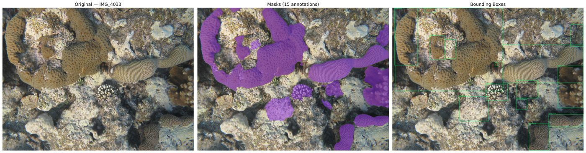
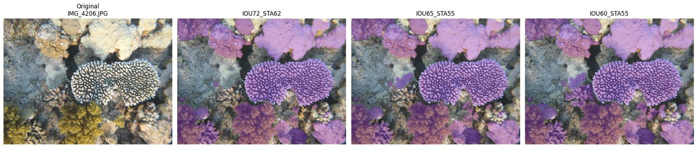
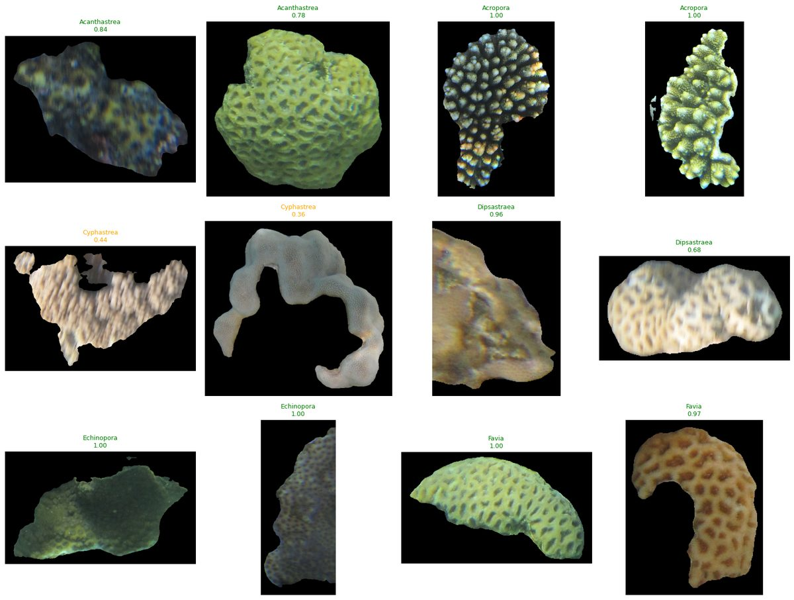
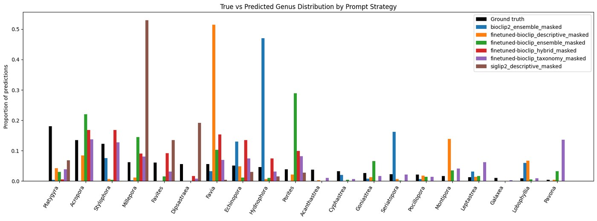
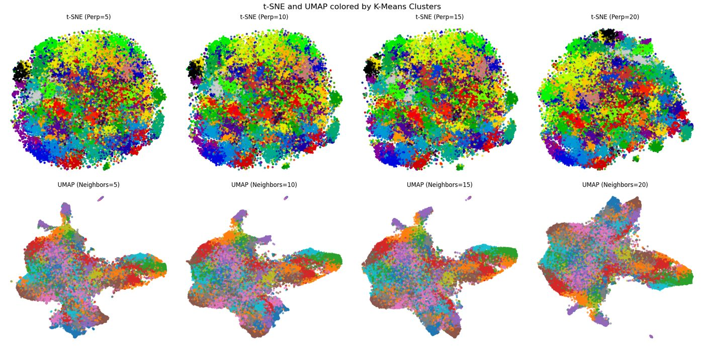

# Onboarding: Red Sea Coral Identifier

Welcome! This guide is for new volunteers. It assumes **no prior computer-vision or machine-learning experience**, just some Python. Read it top to bottom once (about 30 minutes), then do "Your first day" (section 5).

- **Repository:** https://github.com/CoralsINPA/RedSeaCoralIdentifier
- **Shared data (Google Drive, by invitation):** https://drive.google.com/drive/folders/1LtqWRm2vieTbUGgb1ISfsqVD-g-urPRY
- **Where code runs:** Google Colab, in the browser, with a free GPU. Nothing needs installing on your computer.

---

## 1. What the project does

Divers photograph Red Sea reefs. Ecologists want to know **which corals are in each photo**, at the level of the **genus** (for example *Acropora*, *Porites*, *Platygyra*). Labeling thousands of photos by hand is slow, so we build software that does it automatically. An expert, Assaf, checks samples of its work.

The software works in four steps:

```
reef photo ──► 1. find each coral ──► 2. drop bad cut-outs ──► 3. name the genus ──► 4. check against the expert
              (segmentation)          (filters)                (classification)       (evaluation)
```

- **The photo set:** 1,714 photos.
- **Step 1 finds:** 44,211 candidate objects.
- **After the filters:** 16,080 coral cut-outs ("crops").
- **Step 3:** each crop gets one of **20 hard-coral genera**.

Today the model is right about **2 times in 3** on the expert's test crops. The main known errors:
- bare rock and other non-coral objects get forced into a coral genus;
- similar-looking "massive" corals get confused with each other.

Improving this is the current work (section 9).

---

## 2. The ideas you need (no computer-vision background assumed)

**Segmentation: "where is each coral?"**
A model called **SAM** (Segment Anything, by Meta) draws an outline (a **mask**) around every object in a photo. We use **CoralSCOP**, a version of SAM retrained on coral photos. Each mask is stored as a compact code (an "RLE") in a JSON file, one file per photo.


*Segmentation of one photo: the original, the masks CoralSCOP drew (purple), and each mask's bounding box (from `weak_classification.ipynb`).*


*SAM settings change what is found: stricter settings (left) find fewer corals. We use `IOU60_STA55` (right), the most permissive (from `CoralMasking.ipynb`).*

*To see it on the current pipeline:* notebook 01 saved, for photo IMG_8909 ([folder](https://drive.google.com/drive/folders/1TJE66XdraZuNfmIW4lUuvFOypbMYrSK0)): [all SAM masks and their boxes](https://drive.google.com/file/d/1H29q5KPgy4YbcKU3MGLrkQ0IMnT8wbLE/view), [only the masks kept as crops](https://drive.google.com/file/d/1kWWdsXfuVgjq-jd9qovZDB6eloCK9YKa/view) and [every mask colored by why it was kept or dropped](https://drive.google.com/file/d/17y74dnY7f1sV2eN5c6nTDp-c4ej6x3qq/view) (green kept, blue too small, orange inside a bigger mask, purple too thin, red blurry). Run the last cells of notebook 01 with another `SAMPLE_PHOTO` to see any photo. The run's [`visualizations/`](https://drive.google.com/drive/folders/1K8tdekeo-QMs5CAy2fA9IWKGYhh3CP5D) folder has older mask drawings of many photos from the original notebook.

**Crop:** the part of the photo inside one mask. Everything outside the mask is painted black, so the model sees only the coral.

**Filters:** many masks are useless: tiny fragments, long thin slivers, a piece of a coral that's also covered by a bigger mask, or blurry. Four rules remove them:
- size (≥ 25,000 pixels);
- shape (aspect ratio ≤ 3);
- "contained in another mask" (≥ 80% overlap);
- sharpness.

The result is the **manifest**, a table with one row per mask, saying whether it was kept and, if not, why.

*To see it:* the [filter funnel](https://drive.google.com/file/d/18PXlRKGpm48X63v9i2s5FzPJ_79-0Vfe/view) saved by notebook 01: 44,211 masks go in, 16,080 crops come out, and the size filter removes the most.

**Embedding:** a neural network turns an image into a list of numbers, for example 512 of them. Similar-looking images get similar lists. Think of it as coordinates of the image in a "space of appearances". Most of what we do happens on these numbers, not on the pixels.

**Zero-shot classification: naming a genus without training.**
We use **BioCLIP**, a model trained on millions of biology images together with their text descriptions (we use a version fine-tuned on reef images by the ReefNet project). It can embed both an image and a sentence such as "Animalia Cnidaria Anthozoa Scleractinia Acroporidae Acropora". For each crop we compare its embedding with the embedding of each of the 20 genus descriptions and pick the closest. This is "zero-shot" because it never saw our labeled crops.
- **Confidence:** a number from 0 to 1 that says how sure the model is. It is useful for ranking crops, but it isn't a calibrated probability.


*The classifier's output: each crop (outside the mask painted black) with the predicted genus and confidence; green is high confidence, orange is low (from `weak_classification.ipynb`).*


*Predicted genus mix against the survey (black bars). Purple, `finetuned-bioclip_taxonomy_masked`, is the method in use: note Pavona far above the survey and Platygyra far below. The other colors were earlier experiments.*

*To see it on the current baseline:* notebook 02 saved ([folder](https://drive.google.com/drive/folders/1XGBMVg4ZX0SKXRiFk_VmxXoXBNVTn1_1)): [the genus mix against the survey](https://drive.google.com/file/d/1otFyPDwZNhwejjstVYQTIb-xNiifKIcC/view), [the genus mix on landscape and portrait photos](https://drive.google.com/file/d/1LTYhMU7Fr6BEZatYkE_DHYk57xMbw5X9/view), [a heat map of which genera get mixed up on the expert set](https://drive.google.com/file/d/1Tff6De-SYvO2gEeA3NhjYVB9r4LAwsEw/view) and [3 random crops of every predicted genus](https://drive.google.com/file/d/1mzs1gxYawpF7pMjBJ6ILyl-J9g_kTggw/view) (caption green for confidence 0.85 or more, orange 0.5 to 0.85, red below). Every picture notebooks 01 and 02 draw is saved on Drive like this, in a new `reports/figures_01_<date>/` or `figures_02_<date>/` folder of the run; change `SEED` in notebook 02 for another sample of crops.

**Expert evaluation:** Assaf labeled 77 crops by hand. We compare the model's answer with his.
- **Accuracy** is the share it got right.
- **Precision** for a genus: of the crops the model called X, how many really are X.
- **Recall** for a genus: of the real X crops, how many the model found.

**Linear probe (the next step):** once we have enough expert labels, we train a very simple classifier (logistic regression) on top of the embeddings. It learns from *our* examples instead of from text descriptions. That usually beats zero-shot clearly.

**Clustering (exploration):** group crops whose embeddings are close, without using any labels (methods: K-Means, HDBSCAN). We draw the groups as 2-D maps with t-SNE and UMAP, which squash many numbers into 2 for plotting. On 2026-10-14 the clusters, computed with an independent reef model called **DinoVdeau**, showed something important: the model's biggest mistakes are bare rock labeled "Pavona" and giant clams labeled "Lobophyllia". See `docs/clustering_results.md`.


*Clustering maps from the original notebook (`CoralMasking.ipynb`, DINOv2 features): one dot per crop, colors are K-Means clusters. The newer DinoVdeau maps are in the report folder below.*

*To see it:* the [DinoVdeau report folder](https://drive.google.com/drive/folders/1RvzVFn-s-dssqzZ4Fss4qDLJIHU3JDpl) on Drive has the UMAP maps (`maps.png`, `kmeans_maps.png`: one dot per crop, nearby dots look alike) and `inspected_clusters_14-8-4-19-5.pdf`, sample crops of single clusters. The bare-rock cluster called "Pavona" is how the biggest error was found.

---

## 3. Glossary

| Term | Meaning |
|---|---|
| **Genus / genera** | A level of biological classification above species (e.g. *Acropora*). Our output unit. |
| **Hard coral** | Reef-building, stony coral (order Scleractinia), plus fire coral *Millepora*. Our 20 target genera. |
| **Soft coral** | Coral without a stony skeleton (e.g. *Sinularia*). Not in our label set, but it appears in photos. |
| **Growth form** | The overall shape: branching, massive (dome), encrusting, plate, meandroid (brain-like). |
| **Corallite** | The small cup of a single coral polyp. Its size and walls distinguish many massive genera. |
| **Massive complex** | Look-alike dome corals (*Dipsastraea, Favites, Favia, Goniastrea, Leptastrea*…) that the model confuses. |
| **Mask / RLE** | A coral's outline as a black-and-white image, stored compactly as run-length encoding. |
| **Frame** | The size the photo was resized to for segmentation (long side 2,560 px). Landscape 2560×1920, portrait 1920×2560. |
| **Crop** | The cut-out of one mask. |
| **Manifest** | The table of all masks with keep / reject decisions (`manifest.parquet`). |
| **Embedding / features** | The list of numbers a network produces for an image (`.npz` files). |
| **Zero-shot** | Classifying by comparing with text descriptions, with no training on our labels. |
| **Baseline** | The current reference result: zero-shot BioCLIP, 20 genera, all 16,080 crops. |
| **Linear probe** | Logistic regression trained on embeddings with expert labels. |
| **Cluster** | A group of crops with similar embeddings. |
| **Precision / recall / accuracy** | See section 2. |
| **uid** | A crop's identity: `IMG_4033.JPG#14` (photo name + mask number). Every table joins on it. |
| **GPU** | A graphics processor; makes neural networks 20-100× faster. Colab lends one (Runtime → T4 GPU). |

---

## 4. Getting access (checklist)

1. **A Google account with access to the shared Drive.** Ask the project coordinator to share the `CoralsMasking` folder with you. Many files belong to the team account, so access is by invitation only.
2. **Add a shortcut in your own Drive.** In Drive, open the shared `CoralsMasking` folder, choose "Add shortcut to Drive", and place it at `My Drive/colab notebooks/CoralsMasking`. The notebooks expect exactly that path. If you put it elsewhere, change `DATA_ROOT` in the first cell of each notebook.
3. **A GitHub account**, only if you will change code. Reading and running notebooks doesn't need one, because the repository is public.
4. **Nothing to install** for running notebooks. For code work on your own computer, see section 8.

---

## 5. Your first day (about 1-2 hours, mostly waiting)

Open each notebook with its link. Colab opens a copy from GitHub. Run cells top to bottom with Shift+Enter.

| # | Notebook | Runtime | Time | What you'll see |
|---|---|---|---|---|
| 1 | [01_segment_and_filter](https://colab.research.google.com/github/CoralsINPA/RedSeaCoralIdentifier/blob/main/notebooks/01_segment_and_filter.ipynb) | **T4 GPU** | ~12 min | "1714 photos have a mask JSON"; a segmentation check (PASS) that re-segments 5 photos and compares them with the saved masks; photos with colored masks; the filter funnel |
| 2 | [02_zero_shot](https://colab.research.google.com/github/CoralsINPA/RedSeaCoralIdentifier/blob/main/notebooks/02_zero_shot.ipynb) | T4 GPU | ~5 min (loads saved results) | Accuracy on the expert set: **34/51 = 66.7%** on landscape photos; the genus mix against the survey |
| 3 | [05_millepora](https://colab.research.google.com/github/CoralsINPA/RedSeaCoralIdentifier/blob/main/notebooks/05_millepora.ipynb) | any | ~5 min | One genus up close: counts, confidence bands, PDFs of crops |
| 4 | [explore/embeddings](https://colab.research.google.com/github/CoralsINPA/RedSeaCoralIdentifier/blob/main/notebooks/explore/embeddings.ipynb) | any (GPU only to compute new embeddings) | 15-25 min | Maps of all crops, clusters, and sample crops of chosen clusters |

**How to run a notebook:**
1. **Runtime → Change runtime type → T4 GPU** (when the table says so).
2. **Run the first cell.** It asks for Drive permission: choose the account that has the data. It then downloads this repository and installs it (2-4 minutes).
3. **Run the other cells in order.** Each notebook's first text cell explains every step, its time, what it reads and what it writes.

**Every notebook is safe:** it only *reads* the shared data and writes *new* files (a new dated report folder). It never overwrites anything.

---

## 6. Where everything is

**Repository** (`src/coralid/` is the code; notebooks only call it):

```
notebooks/
  01_segment_and_filter.ipynb   step 1-2: masks and the filtered manifest
  02_zero_shot.ipynb            step 3: the baseline classifier and its reports
  03_expert_review.ipynb        step 4: expert-review sheets and their scoring
  04_supervised_probe.ipynb     next step: the linear probe (needs more labels)
  05_millepora.ipynb            one genus up close (Millepora)
  explore/embeddings.ipynb      exploration: embeddings and clusters (separate direction)
  legacy/                       the original notebooks, kept for history
src/coralid/                    the Python package (one module per job; see CLAUDE.md "Layout")
  explore/                      the exploration code (DINO embeddings, clustering)
configs/
  iou60_sta55_pts32.yaml        all run settings (segmentation, filters, model, paths)
  genera.yaml                   the 20 genera and the text prompts
tests/                          automatic checks on synthetic data (no Drive needed)
docs/                           plans, results, ideas (list in section 10)
third_party/CoralSCOP           the segmentation model's code
```

**Shared Drive** (`CoralsMasking/`):

| Path | What |
|---|---|
| `data_all/` | All 1,714 source photos |
| `data_50/` | A 50-photo subset for quick tests |
| `results_all/iou60_sta55_pts32/` | **The active run** (the name encodes the segmentation settings) |
| … `/json/` | One mask file per photo |
| … `/manifest/manifest.parquet` | The filtered crop table (16,080 kept) |
| … `/predictions/` | The baseline's genus predictions for every crop |
| … `/features/` | Embeddings: `finetuned-bioclip__masked.npz` (the classifier's), `dinovdeau-l__masked_square.npz` (exploration) |
| … `/reports/` | One dated folder per report run |
| … `/reviews/` | Expert-review sheets; `keys/` holds hidden answer keys, **don't share them** |
| … `/assaf_expert_test_set.csv` | The 77 expert-labeled crops |
| `ground_truth_genus_counts.csv` | The ecologists' survey counts per genus |
| `CoralSCOP/checkpoints/vit_b_coralscop.pth` | The segmentation model's weights |

**Archives:** `archive/` folders, in the root and in the active run, hold outdated files: old embedding CSVs, early zero-shot experiments, old clustering output, defective crops, the excluded V2 pipeline. Each has a `README_archive.txt`. The code reads none of them.

**Ignore:** `external_libs/`, `results_50/` and `cropped_masks/` in the root, and a few old files in the run folder that still wait to be archived: `coral_dinoV2_encodings*.csv`, `cluster_summary*`, `coral_results.csv`, `visualizations/`.

---

## 7. Rules (please read)

1. **Never overwrite or delete shared data on Drive.** The code refuses to overwrite. Don't work around it. New results go into new files or folders.
2. **The repository is public:**
   - never commit data files (images, CSV, parquet, npz, model weights);
   - never commit passwords, tokens or personal details.
3. **Keep notebooks thin.** Logic goes into `src/coralid/` (with a test); notebooks only call functions and show results. No function definitions in notebooks, and outputs are stripped before committing.
4. **Every change passes the checks** before it's committed (section 8).
5. **Work on a branch and open a pull request.** Never push to `main` directly. Someone reviews before merging.
6. **Report results honestly.** Give numbers with how they were measured (which crops, which labels). Keep landscape and portrait photos separate when using the expert set: its portrait labels were given on badly cut crops.
7. **Expert time is the scarcest resource.** Plan any request to Assaf carefully, and batch it with others.

---

## 8. Changing code (when you're ready)

**One-time setup** (Python 3.10+):

```bash
git clone --recurse-submodules https://github.com/CoralsINPA/RedSeaCoralIdentifier
cd RedSeaCoralIdentifier
python -m venv .venv && source .venv/bin/activate
pip install -e ".[dev]"
```

**Before every commit:**

```bash
ruff check . && ruff format --check . && pytest -q
```

All three must pass. The tests use synthetic data, so they run on a laptop without Drive or a GPU.

**Typical workflow:**
1. `git checkout -b my-change`.
2. Edit code in `src/coralid/` and add a test in `tests/`.
3. Run the checks.
4. Commit, push, and open a pull request on GitHub.
5. To try it on real data, set `BRANCH = "my-change"` in a notebook's first cell, and that notebook runs your branch.

**Command line,** the same jobs as the notebooks, for a machine with a GPU and the data: `python -m coralid --help`. For example, `python -m coralid zero-shot --config configs/iou60_sta55_pts32.yaml`.

---

## 9. Current status and where to help (October 2026)

**Done:**
- The shared Drive was tidied (2026-10-14). Outdated files moved, not deleted, into `archive/` folders.
- The notebooks and this guide point to the `main` branch.
- The original notebooks were reorganized into a tested package.
- A bug that mis-cut all 221 portrait photos was fixed.
- The baseline was re-run on all 16,080 crops.
- Everything was verified end to end on the real data.

**Open housekeeping:** the photos (`data_all/`), the masks (`json/`) and `results_all/` are owned by one volunteer's personal Google account. Their ownership should move to the team account so the project never depends on one person's account.

**Known problems** (details in `docs/clustering_results.md` and `docs/algorithm_ideas.md`):
- **Non-coral forced into a genus.** "Pavona" is predicted 34× more often than in the survey; much of it is bare rock. Giant clams are called "Lobophyllia".
- **Under-called genera.** Brain corals (*Platygyra*) get low confidence or the wrong label.
- **Weak filters.** The blur filter almost never fires, and the size filter drops about half of all masks, including many small real colonies.
- **Too few test labels.** The expert test set (77 crops) is too small to measure small improvements.

**The plan** (`docs/algorithm_ideas.md`, "Proposed plan"):
1. The expert names each crop cluster from a grid of examples.
2. A gate rejects non-coral crops (rock, clams).
3. A linear probe names the genus.
4. Crops where the models disagree are flagged instead of guessed.
5. A blind expert test set of about 300 crops measures the result.

**Good first tasks:**
- Look through the remaining "Pavona" clusters: set `INSPECT` in the last code cell of the exploration notebook. Report what the crops are.
- Write the measure of cluster purity against predicted genus mentioned in `docs/clustering_results.md` ("Next").
- Improve the blur measure (`docs/algorithm_ideas.md` §2): measure sharpness inside the coral only.

---

## 10. Further reading

**In this repository:**

| Document | Read it for |
|---|---|
| `README.md` | A short overview and the Drive links |
| `docs/algorithm_ideas.md` | Every improvement idea, with evidence and cost, and the proposed plan |
| `docs/clustering_results.md` | What the clusters showed (with crop examples described) |
| `docs/exploration_embeddings.md` | The exploration direction and how to run it |
| `docs/onboarding_errata.md` | Where the older PDF guide (`docs/legacy/Coral_Pipeline_Onboarding_Guide.pdf`) is out of date |
| `docs/agent_memory/` | The detailed project history and results of each work session |
| `CLAUDE.md` | A dense technical map of the code, written for AI assistants but useful for people too |

**Background, outside the repository:**
- **Segment Anything (SAM):** https://segment-anything.com
- **CoralSCOP (our segmentation model):** https://github.com/zhengziqiang/CoralSCOP
- **BioCLIP:** https://imageomics.github.io/bioclip/
- **The fine-tuned model we use:** https://huggingface.co/ReefNet/finetuned-bioclip
- **DinoVdeau (exploration model):** https://huggingface.co/lombardata/DinoVdeau-large-2024_04_03-with_data_aug_batch-size32_epochs150_freeze
- **Google Colab basics:** https://colab.research.google.com
- **pandas in 10 minutes** (tables, used everywhere): https://pandas.pydata.org/docs/user_guide/10min.html
- **Git and GitHub for beginners:** https://docs.github.com/en/get-started/start-your-journey
- **Coral identification reference:** Corals of the World, http://www.coralsoftheworld.org

---

## 11. Troubleshooting

| Problem | Fix |
|---|---|
| "DATA_ROOT exists but has no results_all/ folder" | Drive is mounted with the wrong Google account. Runtime → Disconnect and delete runtime, run the first cell again, and choose the account with the data. |
| "DATA_ROOT not found" | The Drive shortcut is missing or in another place (section 4, step 2), or change `DATA_ROOT`. |
| "RESTART THE RUNTIME" | Runtime → Restart session, then run the first cell again. This happens once after installing. |
| A cell sits at 0% for many minutes | Probably no GPU. Run `import torch; print(torch.cuda.is_available())`. If False: Runtime → Change runtime type → T4 GPU. Free GPU quota can run out for a day. |
| Colab disconnected during a long job | Run the first cell, the config cell and the job cell again. Long jobs resume where they stopped. |
| "refusing to overwrite" / "exists" | This is by design: the file is already there. Use the existing result, or ask before changing anything. |
| Warnings about HF_TOKEN or "UNEXPECTED" keys | Harmless. |

**Stuck?** Ask in the project chat with the notebook name, the cell number, and the full error text.
